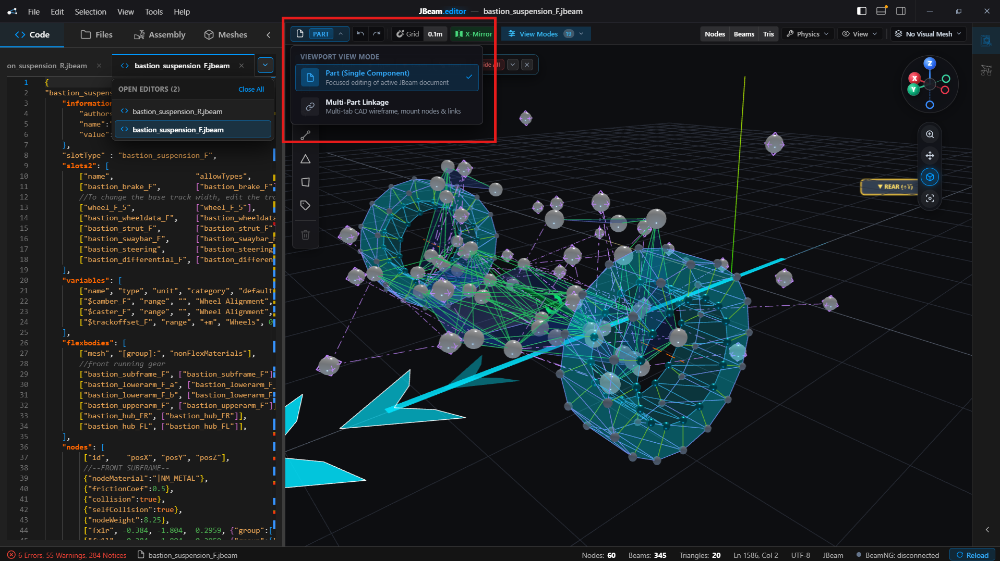
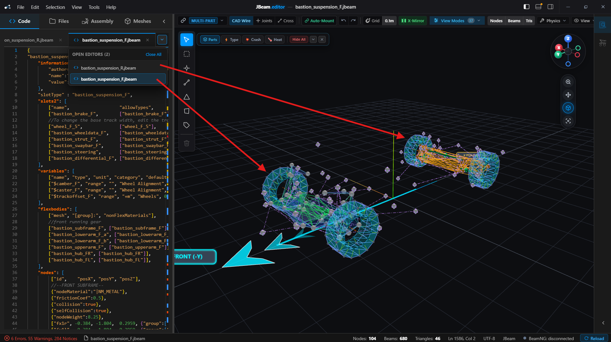
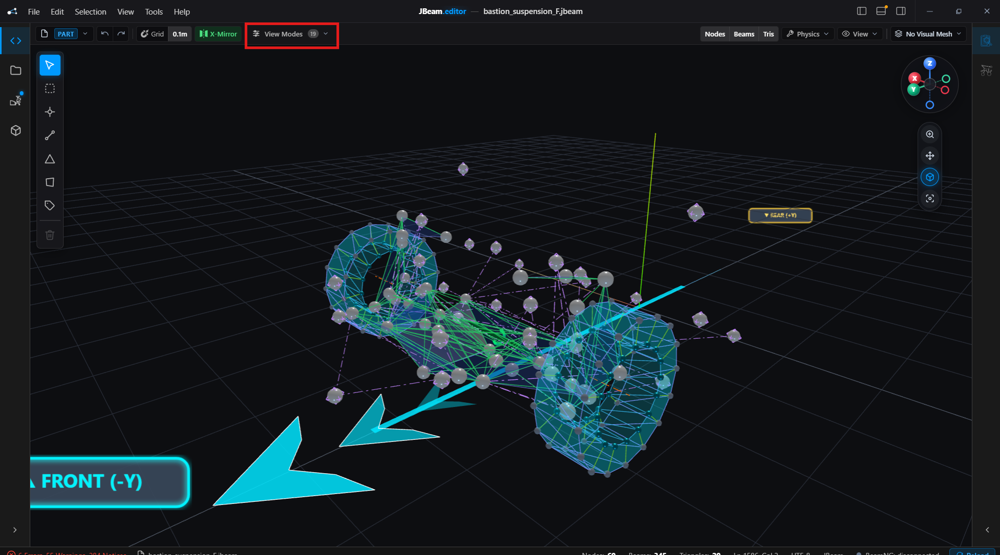
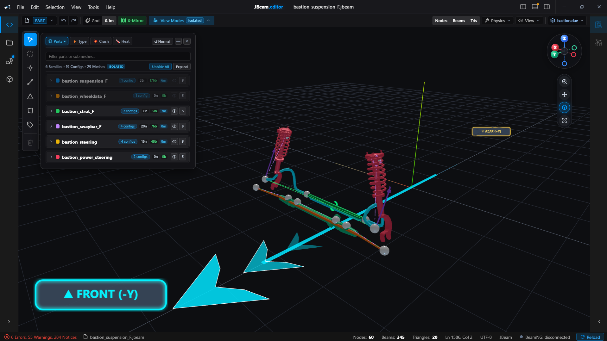
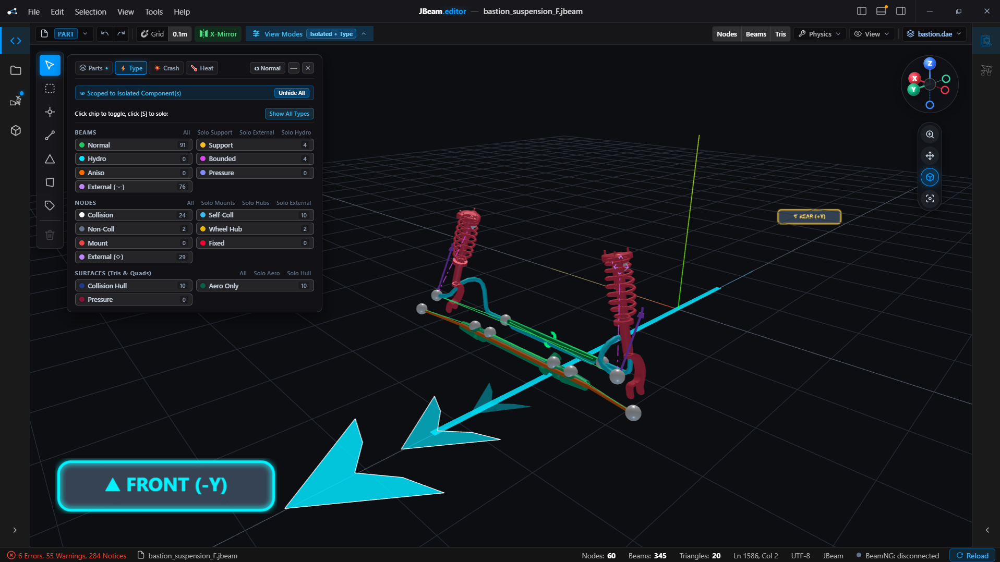
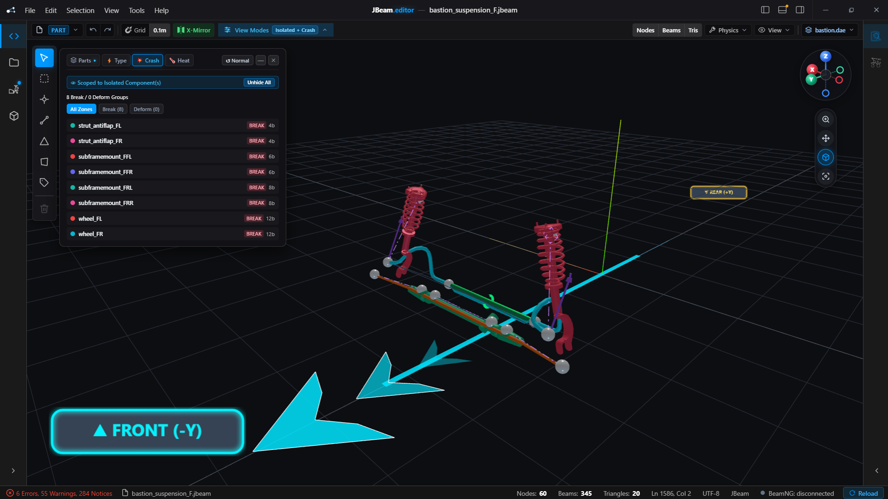
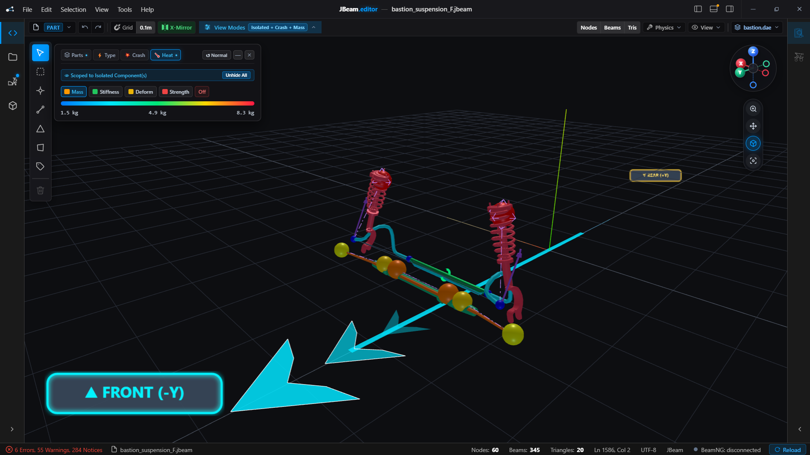
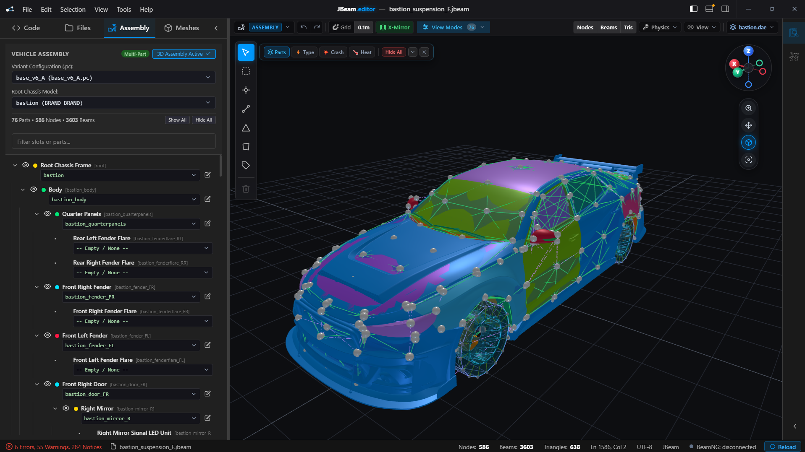
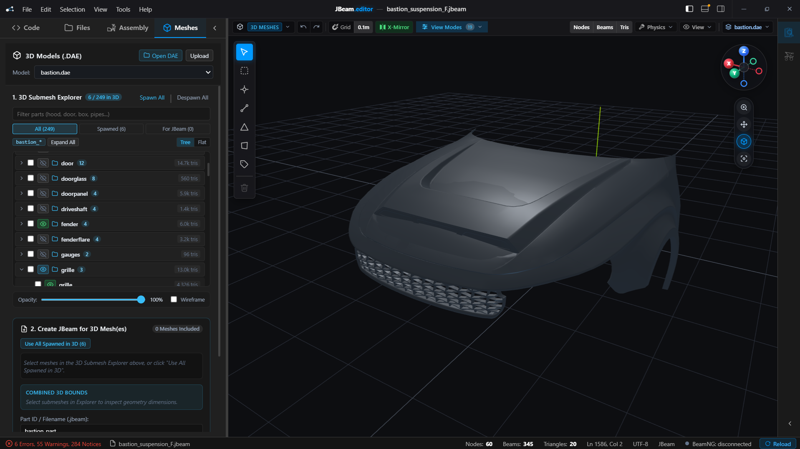

# 3D Viewport & View Modes

The **3D Structure Viewport** (WebGL / Three.js) renders your vehicle's nodes, beams, triangles, quads, Collada `.dae` visual meshes, and live physics overlays.

---

## 1. Camera Navigation & Orientation Gizmo

- **Orbit**: Middle-mouse drag (or Left-drag on empty space when in camera/orbit).
- **Pan**: <kbd>Shift</kbd> + Middle-mouse drag (or Right-drag).
- **Zoom**: Mouse scroll wheel.
- **Blender-Style Orientation Gizmo** (top-right): Click **X / -X / Y / -Y / Z / -Z** axis spheres to snap smoothly to Front (`-Y`), Rear (`+Y`), Left (`+X`), Right (`-X`), Top (`+Z`), or Bottom (`-Z`) orthographic views.
- **Viewport Overlay Controls** (`View` dropdown):
  - **Nodes / Beams / Tris** quick toggles in the top-right viewport bar.
  - **Background Themes**: *Editor Gray* (`#1e2127`), *Theme Charcoal* (`#1a1a1a`), *CAD Slate* (`#282c34`), and *Pitch Black* (`#0d0e11`).
  - **Grid Snapping**: Toggle grid snap and step size (`0.1m`, etc.) in the top viewport bar.

---

## 2. Viewport Source Modes (`Part` · `Multi-Part` · `Assembly`)

Switch the active viewport scope from the top-left viewport selector:

| Mode | What It Shows | Best Used For |
| :--- | :--- | :--- |
| **Part** | Only the currently active `.jbeam` file | Focused editing of a single part (`suspension_F`, `door_FL`, etc.) |
| **Multi-Part** | All currently open editor tabs combined in one 3D scene | Comparing and connecting adjacent parts (`suspension_F` + `body` + `subframe`) |
| **Assembly** | Full vehicle assembled from `.pc` config & `slots`/`slots2` tree | Full-vehicle inspection, wheel fitment, CoG, aerodynamics, and `.dae` alignment |

### Multi-Part Mode Tools (`CAD Wire` · `Joints` · `Cross` · `Auto-Mount` · `Clash Inspector`)
When **Multi-Part** mode is active, additional controls appear in the viewport bar:
- **Background Tab Style (`CAD Wire` / `Joints` / `Cross`)**: Control how non-active open tabs render (wireframe/ghost, joint anchors, or cross-part connections).
- **Auto-Mount / Virtual Cross-Part Beams**: Visualizes cross-part beam connections (`|VIRTUAL` dash-dot lines) and external reference node diamond cages.
- **Clash Inspector**: Detects overlapping/coincident nodes across open parts and lets you highlight or inspect them in 3D.

---

## 3. View Modes Floating HUD (`Parts` · `Type` · `Crash` · `Heat`)

Click **View Modes** in the top viewport bar to open the floating inspection HUD:

### `Parts` Tab (3-Level Component Family & DAE Hierarchy)
- Groups parts by **File** (in Multi-Part mode), **Component Family** (e.g., `bastion_suspension_F`, `bastion_strut_F`, `bastion_swaybar_F`), **Config/Variant**, and bound **DAE Submeshes**.
- **Eye (`👁️`)**: Toggle visibility per family, part, or submesh.
- **Solo (`S`)**: Isolate a single part, family, or flexbody (automatically suppressing unrelated physics skeletons and unassociated `.dae` meshes).
- **`Hide All` / `Unhide All` & `Expand`**: Quickly clear or expand the tree.

### `Type` Tab
- Colors and filters **Beams** (`Normal`, `Hydro`, `Aniso`, `External (---)`, `Support`, `Bounded`, `Pressure`), **Nodes** (`Collision`, `Non-Coll`, `Mount`, `External (◇)`, `Self-Coll`, `Wheel Hub`, `Fixed`), and **Surfaces** (`Collision Hull`, `Aero Only`, `Pressure`).
- Click any chip to toggle visibility or click `[S]` / quick solo buttons (`Solo Support`, `Solo External`, `Solo Hydro`, `Solo Mounts`, `Solo Hubs`, `Solo Aero`, `Solo Hull`).

### `Crash` Tab
- Decodes `breakGroup` (detachment) and `deformGroup` (crumple/glass shatter) zones with distinct colors, tallies, *All Zones / Break / Deform* filters, and 1-click soloing.

### `Heat` Tab
- **Engineering Heatmaps**: Switch between **Mass** (`nodeWeight` in kg), **Stiffness** (`beamSpring`), **Deform** (`beamDeform`), **Strength** (`beamStrength`), or **Off**, with a live `min` / `mid` / `max` color ramp.

---

## 4. Assembly Manager & Collada (`.dae`) Meshes

### Vehicle Assembly (`Assembly` Sidebar Tab)
- Automatically indexes all `.jbeam` parts and `.pc` vehicle configurations in the workspace.
- Load any `.pc` preset, swap parts in `slots`/`slots2` dropdowns, and toggle individual part visibility (`👁️`).

### Dedicated 3D Meshes (`Meshes` Sidebar Tab)
- Loads `.dae` files with a multi-level underscore submesh tree (folders-first sorting) and multi-color submesh sync.
- **Spawn / Solo Submeshes**: Check individual submeshes (`hood`, `fender_L`, `wheel`) to overlay them with adjustable ghost opacity.
- **1-Click JBeam Scaffolding**: Generate a starter `.jbeam` part with auto-bound `flexbodies` directly from selected `.dae` submeshes.

---

## 5. Detached Viewport (Multi-Monitor Popout)

Click **Detach Viewport** in the **View** menu (or top-right titlebar) to pop the 3D viewport into a separate window for dual-monitor setups. All edits, selections, and `.dae` overlays sync in real time; click **Dock Window** to re-attach.
