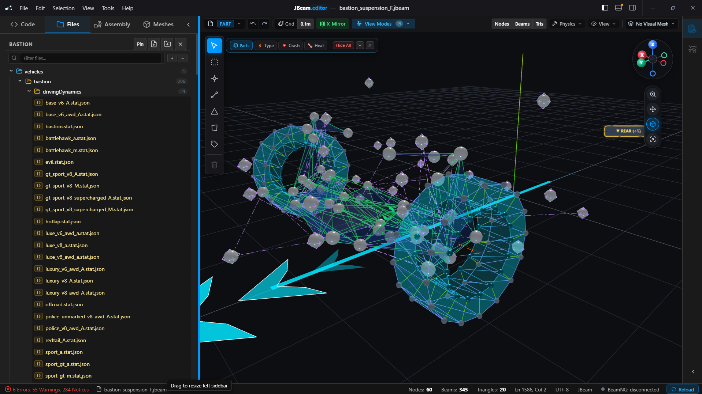

# File Explorer & Code Editor

## 1. Project File Explorer (`Files` Tab)

The **Files** panel in the left activity bar lets you browse, filter, and open files across your vehicle mod folder without leaving your current workflow.

### Features & How to Use Them
- **Hierarchical Tree & Indent Guides**: Folders expand/collapse with a **single click** and display vertical indent guide lines and item count badges.
- **Distinct File & Folder Badges**: Color-coded icons and extension badges distinguish `.jbeam` (`JB`), `.dae` (`3D`), `.pc` (`PC`), `.json` (`{}`), `.html` (`</>`), `.css` (`#`), `.js`/`.ts`/`.lua`, and texture/image files (`.dds`, `.png`, `.jpg`).
- **Quick Filter & Tree Controls**:
  - Type in `Filter files...` to narrow the tree by filename (auto-expanding matching folders).
  - Click `+` (**Expand All Folders**) or `−` (**Collapse All Folders**) next to the search bar.
- **Opening Multiple Files Without Switching Tabs**:
  - **Normal Click**: Opens the file and switches to the Code editor.
  - **`Pin` Button**: Toggle **Pin** ON in the explorer header to stay in the Files panel while clicking through multiple files.
  - **Background Open (`+` button or `Ctrl+Click`)**: Opens any file in a background tab without leaving the Files panel. Open files show a status dot on their row.
- **Create File / Folder**: Use the **New File** and **New Folder** buttons in the explorer header to create files/folders inline.

---

## 2. Monaco JBeam Source Code Editor

Powered by the Monaco engine (VS Code's editor) with custom BeamNG JBeam intelligence:

### Syntax & Readability
- **Monarch JBeam Grammar**: Highlights official BeamNG section keys (`nodes`, `beams`, `triangles`, `quads`, `slots`, `slots2`, `variables`, `flexbodies`, `pressureWheels`, `torsionbars`, `rails`, `slidenodes`, `refNodes`, `camerasInternal`, `powertrain`).
- **Rainbow Bracket Colorization**: Visually pairs nested `{}` and `[]` levels across large tables.
- **Code Folding & Minimap**: Collapse individual parts or sections with one click.

### Hover Documentation & 3D Code-to-Viewport Highlighting
- **Hover Docs**: Hover over any BeamNG property key (e.g., `beamSpring`, `beamDeform`, `nodeWeight`, `wheelOffset`) to view official parameter descriptions and units.
- **Hover / Selection 3D Highlight**: Hovering or selecting lines inside `nodes`, `beams`, `triangles`, or `quads` highlights those exact elements in the 3D viewport.

### Cascading Node Rename (`F2`)
1. Place the cursor on any node ID in the code editor and press <kbd>F2</kbd> (or right-click → **Rename Symbol**).
2. Type the new node ID and press <kbd>Enter</kbd>.
3. JBeam.editor updates the node definition **and every reference** across `beams`, `triangles`, `quads`, `torsionbars`, `rails`, `slidenodes`, `pressureWheels`, `refNodes`, and `camerasInternal`.
4. If **X-Mirror Symmetry** is enabled, the symmetrical partner node (e.g. `fx1r` ↔ `fx1l`) is renamed automatically as well.
