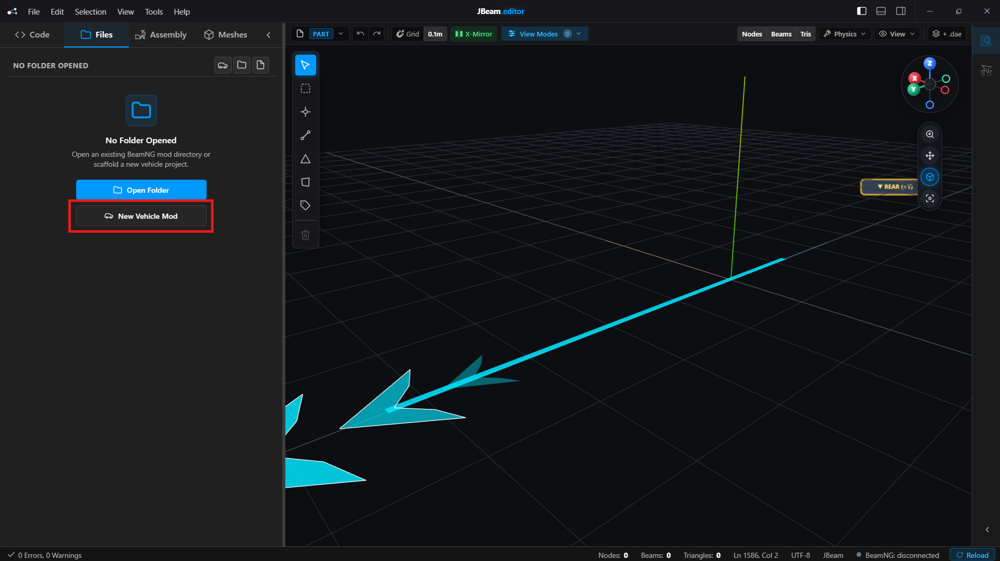
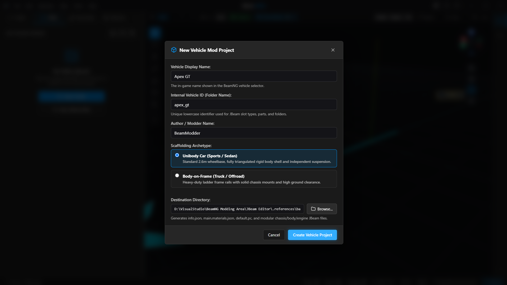

# Getting Started

This guide covers installing **JBeam.editor**, opening an existing BeamNG.drive vehicle mod, or scaffolding a brand-new vehicle project.

---

## 1. Installation & Launch

### Option A: Windows Installer (Bootstrapper)
Run `launch-installer.bat` from the repository root (or download the latest release from [GitHub Releases](https://github.com/JagaTheGhost/JBeam.editor/releases)). The bootstrapper automatically detects your **BeamNG.drive Steam installation** and **userfolder**.

### Option B: Development Mode
```bash
git clone https://github.com/JagaTheGhost/JBeam.editor.git
cd JBeam.editor/jbeam-studio
npm install
npm start
```

---

## 2. Opening a Mod or Creating a New Vehicle

You can start working from either the **File** menu or the **Files** sidebar:

- **Open Workspace Folder** (`File → Open Folder...`): Select your vehicle mod directory (e.g. `vehicles/my_car/`). JBeam.editor automatically indexes all `.jbeam` parts, `.pc` configurations, and `.dae` 3D meshes.
- **Open Individual File** (`File → Open File...`): Open any standalone `.jbeam` file directly.
- **New Vehicle Mod Project** (`File → New Vehicle...` or the New Vehicle icon in the Files panel): Opens the **New Vehicle Wizard** (`NewVehicleModal`) to scaffold a complete starter vehicle folder with `main`, chassis, suspension, and wheel templates.





---

## 3. Workspace Layout

JBeam.editor is organized into five dockable regions:

1. **Top Menu & Titlebar**: `File`, `Edit`, `Selection`, `View`, `Tools`, `Help`, plus quick layout toggles (`Toggle Primary Sidebar` <kbd>Ctrl+B</kbd>, `Toggle Bottom Panel`, `Toggle Secondary Sidebar`, and `Detach Viewport`).
2. **Primary Sidebar (Left)**:
   - **Code** (`<>`): Focus/switch to the Monaco editor.
   - **Files**: Hierarchical Project File Explorer.
   - **Assembly**: Vehicle Slot Manager & `.pc` Configuration loader.
   - **Meshes**: Collada (`.dae`) Submesh Explorer & JBeam generator.
3. **Center Split Area**: **Monaco JBeam Editor** (left) and **3D WebGL Viewport** (right) separated by a draggable splitter. You can also collapse either side for **Code Focus** or **3D Focus**.
4. **Secondary Sidebar (Right)**: **Inspector** (selected element properties) and **Structure** (searchable tree of parts, nodes, beams, triangles, and quads).
5. **Bottom Panel & Status Bar**: **Problems** (`JBeam Diagnostics` + `BeamNG Game Log`) and live error/warning counts, active file name, and SimConnection status.
