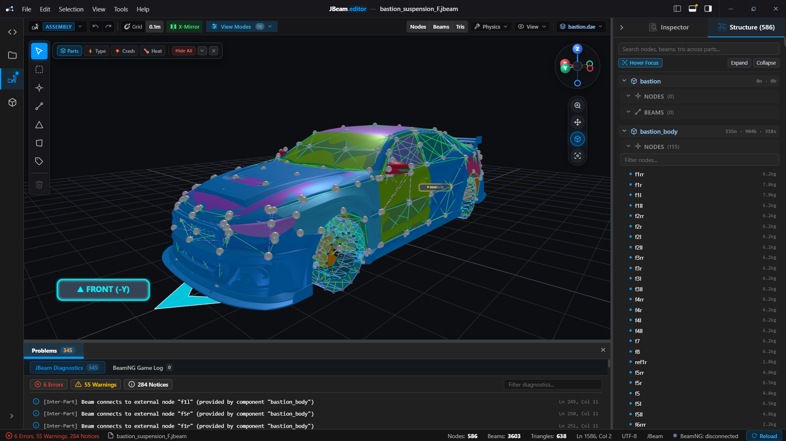
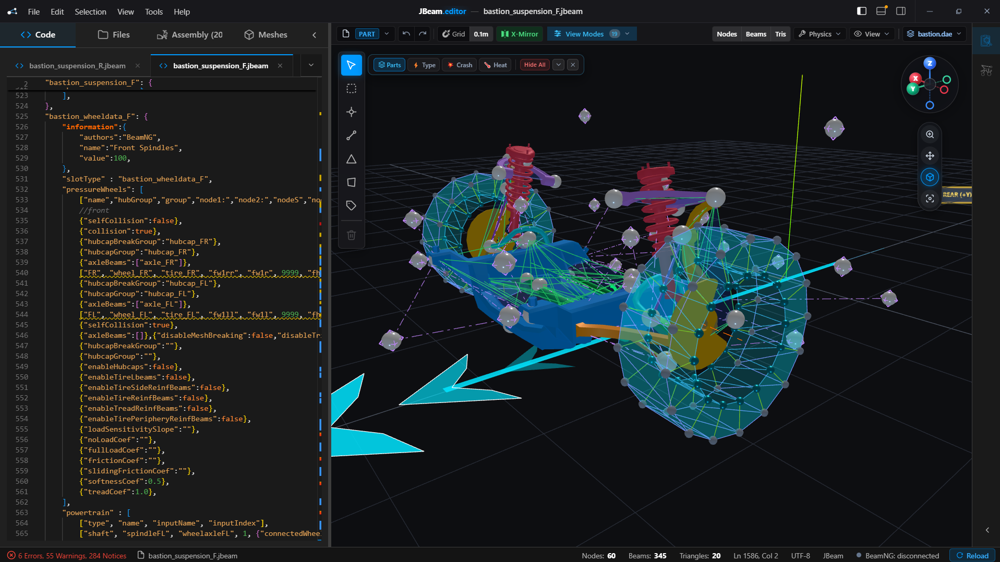

# JBeam.editor Wiki

Welcome to the official **JBeam.editor** documentation! This wiki documents every tool, panel, viewport mode, and physics diagnostic in JBeam.editor in the style of BeamNG.drive's official modding documentation.

---

## Quick Navigation

| Section | What It Covers |
| :--- | :--- |
| **[Getting Started](Getting-Started)** | Installation, opening a vehicle mod folder, New Vehicle Mod scaffolding, and workspace layout |
| **[File Explorer & Code Editor](File-Explorer-and-Code-Editor)** | Project tree, file badges, `Pin` mode, Monaco JBeam editor, hover docs, `F2` rename, lossless AST sync |
| **[3D Viewport & View Modes](3D-Viewport-and-View-Modes)** | `Part` / `Multi-Part` / `Assembly` modes, `View Modes` HUD (`Parts`, `Type`, `Crash`, `Heat`), `.dae` meshes, Detached Viewport |
| **[3D Modeling & Selection Tools](3D-Modeling-and-Selection-Tools)** | Left Tool Shelf, cluster gizmos, `X-Mirror` symmetry, `Alt+F` Topology Focus, Blueprints, OBJ Converter |
| **[Physics Diagnostics & Wheels](Physics-Diagnostics-and-Wheels)** | `PressureWheels` & `Ghost Wheels`, TorsionBars, SlideNodes, CoG, Aerodynamics & CoP, `refNodes`, Cockpit Cameras |
| **[Inspector, Structure & Diagnostics](Inspector-Structure-and-Diagnostics)** | Element Inspector, Structure Tree hover isolation, Problems severity filters, BeamNG Game Log, SimConnection |
| **[Keyboard Shortcuts](Keyboard-Shortcuts)** | Complete cheat sheet of editor, viewport, selection, and simulation shortcuts |
| **[Screenshots Checklist](Screenshots-Checklist)** | Exact list of screenshots to capture for this Wiki and `README.md` |

---

## Core Concepts

### 1. Lossless Bidirectional AST Synchronization
JBeam.editor parses SJSON/JBeam into an AST with exact source character ranges:
- **Code → 3D**: Editing coordinates, beams, triangles, quads, or `pressureWheels` in Monaco updates the 3D viewport live.
- **3D → Code**: Dragging a node gizmo, adding a beam, flipping a face normal, or renaming a node writes **only** the targeted values back to your `.jbeam` file—preserving all `//` and `/* ... */` comments, whitespace, and table headers.

### 2. BeamNG Coordinate System
JBeam.editor aligns its 3D grid and orientation gizmo to BeamNG.drive's official right-handed vehicle coordinate system:
- **X-Axis**: Lateral (`+X` = Vehicle Left / Driver's side, `-X` = Vehicle Right / Passenger's side)
- **Y-Axis**: Longitudinal (`-Y` = Front, `+Y` = Rear)
- **Z-Axis**: Vertical (`+Z` = Up, `-Z` = Down)
